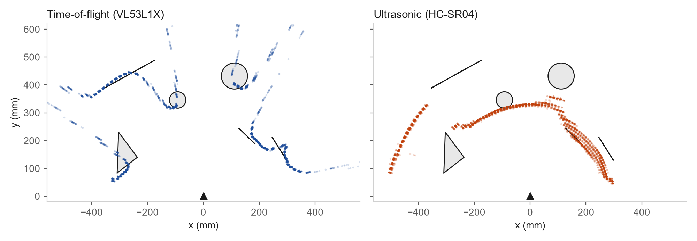
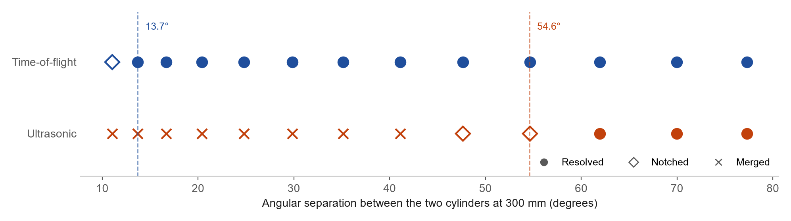

## Background

This project started as a problem in ARC-000, my first scanning rangefinder. The HC-SR04 ultrasonic sensor on that build drew objects much wider than they actually were, and switching to a VL53L1X time-of-flight sensor fixed the scans. Instead of moving on, I decided to characterize both sensors properly and find out exactly how and why they differ.

## Test rig

I designed a printed fixture that mounts both sensors on a single servo, with the time-of-flight sensor directly above the ultrasonic transducers. Mounting them together means every sample is a paired measurement of the same scene at the same moment, so any difference in the data comes from the sensors and not from the setup.

I placed six objects between 264 and 527 mm from the sensor, including flat, rotated, metallic, and porous targets, and measured each one into Cartesian coordinates. I then wrote a Python ray-cast model that uses those coordinates to generate the true range at every scan angle, which gave me a ground truth to compare each sensor against.

Before final collection, I ran dry runs against that ground truth and found and corrected 12 firmware and pipeline defects. Two of the most important were a silent −38 mm bias in the time-of-flight readings and a shared timeout that cut the ultrasonic listening range from 1,500 to 1,114 mm. I also replaced an earlier screenshot-only test round with structured logging, which produced 9,720 rows across 20 sweeps with none rejected.

## Results

The biggest difference between the sensors is angular resolution. I swept two cylinders at 300 mm across thirteen separations. The time-of-flight sensor resolved them down to 13.7°, which is below its 17° nominal field of view, while the ultrasonic sensor needed 54.6° before it could separate them at all.

The ultrasonic sensor's errors came from beam geometry, target orientation, and surface material rather than from its ability to measure distance. When I aimed it at a target 514 mm away it read 330.8 mm, but that reading landed within 2.3 mm of the nearest surface anywhere in its beam, with a standard deviation of 0.07 mm. The sensor measured the closest object accurately; it just could not tell me which object that was.

Surface material had a large effect on the ultrasonic readings. A target rotated about 45° to the beam deflected the sound away from the sensor and produced a +223 mm error, porous foam increased the scatter by 155×, and cylinders read about 15 mm long. The time-of-flight sensor was not affected by any of these.

I also calibrated both sensors on a 14-station range ladder from 100 to 750 mm and found scale errors in opposite directions, −2.58% for the ultrasonic sensor and +1.40% for the time-of-flight sensor. I measured 1.43° of backlash in the servo and confirmed with a settle-time test that the offset was mechanical and not a timing issue.

## What comes next

I am writing the final engineering report now. The MATLAB analysis follows a seven-rule analysis contract I defined before looking at the results, including per-direction angle offsets and correcting for the speed of sound before applying any scale correction.
